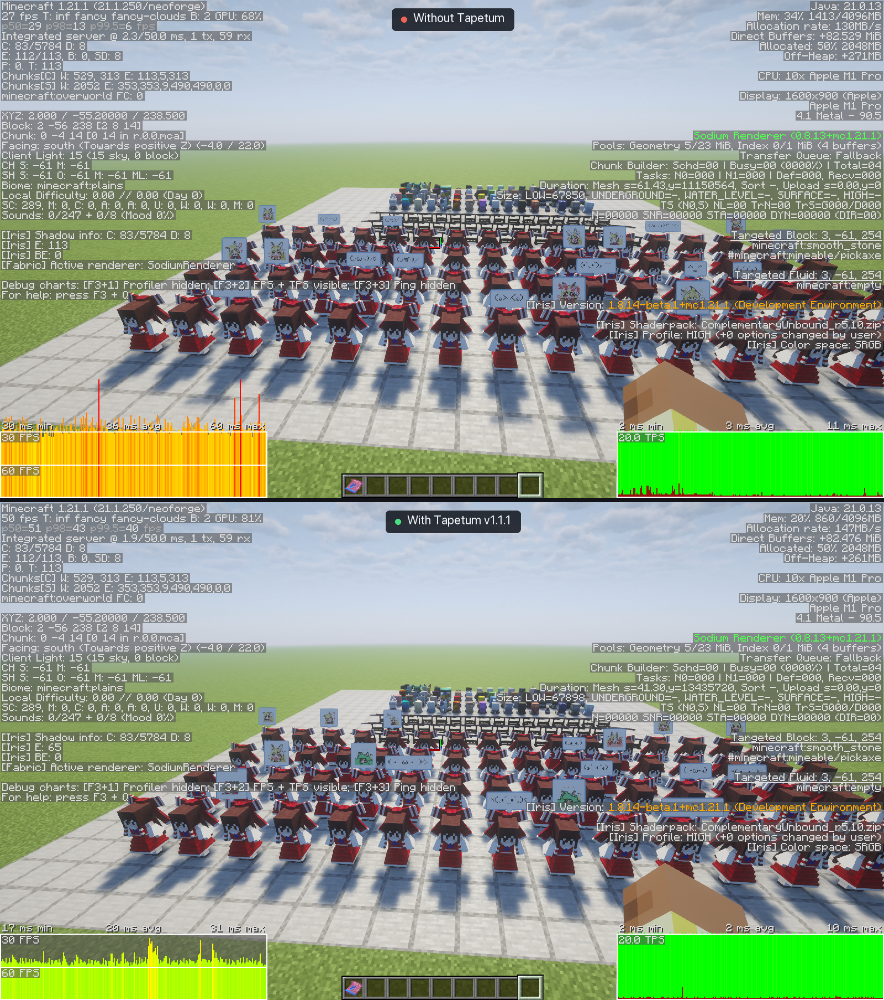

# Tapetum

<p align="center">
  
</p>

**Accelerates entity, armor, and high-poly modded model rendering when running shaders with Sodium/Embeddium and Iris/Oculus.**

Named after the *tapetum lucidum*, the reflective crystal layer behind a cat's iris, **Tapetum** removes the per-frame CPU bottleneck that happens when Minecraft entities and high-poly mod models are drawn into Iris and Oculus extended shader vertex buffers.


## Why Frame Rates Drop Around Entities With Shaders

Without shaders, Sodium and Embeddium write entity cubes straight into compact 36-byte buffers. As soon as you enable an Iris or Oculus shader pack, every entity, armor piece, block entity, and modded model must be emitted in an extended 54-byte shader layout with per-face tangents, mid-texture coordinates, and material IDs. Most mods (and even vanilla model parts or enchanted glint wrappers) fall back to slow per-vertex conversion, recalculating tangents and allocating temporary vectors on the render thread every single frame.

## What Tapetum Does

- **Direct shader buffer writing for vanilla & modded entities**: Pre-computes face and smooth tangents plus mid-UV coordinates once per model, then streams transformed vertices directly into Iris and Oculus off-heap shader buffers without per-frame conversion passes.
- **Fast-path enchanted glint**: Keeps enchanted armor and weapons on the direct buffer writer fast path instead of dropping back to vertex-by-vertex dual consumer calls.
- **Built-in high-poly mod adapters (all optional, 1.21.1)**: Automatically detects and accelerates models from:
  - **GeckoLib 4** & **AzureLib** (entities, armor, and animated geo models)
  - **Timeless and Classics Zero (TaCZ)** (gun models, Gun Smith Table static baking, batch preservation, and idle thermal-scope fast exit)
  - **Touhou Little Maid**, **SimpleBedrockModel**, & **Kaleidoscope Doll** (bedrock/geo model baking and deduplicated main + shadow pass animation evaluation)
  - **SlashBlade: Resharped** (pre-baked OBJ triangle meshes with smooth shader tangents)
- **Smart shadow-pass culling**: Skips redundant shadow draws for tiny decorative overlays, distant detail layers, and static display blocks beyond a configurable radius while keeping primary character silhouettes intact.
- **Live status & per-module toggles**: Open the config screen via Mod Menu (Fabric) or the Mods list (Forge & NeoForge) to see whether the direct shader writer is active, which mod adapters are loaded, and how many meshes are currently pre-baked.


## Performance

Tapetum targets **CPU-side entity, armor, and block-entity vertex emission** when shaders are active, pre-baking local normals, `midUV`, and Iris-compatible tangents once per model and streaming transformed 54-byte vertices directly into off-heap buffers. It does not touch GPU shaders, chunk meshing, lighting, or world generation.



*Same world, fixed camera (`XYZ: 2.0 / -55.2 / 238.5`), and Complementary Unbound `r5.10` (`HIGH`, `1600×900`, `Apple M1 Pro`, `1.21.1` NeoForge, Sodium `0.8.13`, Iris `1.8.14-beta.1`, captured after 15 s warmup + 10 s steady-state): in Scene 2 (64 Touhou Little Maids + 48 Enchanted SlashBlade Stands + 64 Kaleidoscope Dolls), the native `F3+2` frametime graph drops from **`27 fps` (`36 ms avg`, `p99.5 = 6 fps`)** without Tapetum to **`50 fps` (`20 ms avg`, `p99.5 = 40 fps`)** with Tapetum `v1.1.1`.*

### Real-World In-Game Shader Benchmark (A/B)

Measured back-to-back on the same world and fixed camera (`Apple M1 Pro`, Minecraft `1.21.1` NeoForge, Sodium `0.8.13`, Iris `1.8.14-beta.1`, Complementary Unbound `r5.10`):

| Scene | Baseline Avg FPS | Tapetum `v1.1.1` Avg FPS | Avg Gain | Baseline 1% Low | Tapetum `v1.1.1` 1% Low |
| :--- | :--- | :--- | :--- | :--- | :--- |
| **Scene 1** (`1708×960`, HUD hidden): 240 Enchanted Armor Stands (Diamond & Netherite + Shields + Swords) | `17.6 FPS` | **`23.3 FPS`** | **`+32.5%` (`1.33x`)** | `5.1 FPS` | **`5.9 FPS`** |
| **Scene 2** (`1708×960`, HUD hidden): 176 High-Poly Modded Entities (64 Touhou Little Maids + 48 Enchanted SlashBlade Stands + 64 Kaleidoscope Dolls) | `24.6 FPS` | **`64.8 FPS`** | **`+163.4%` (`2.63x`)** | `7.8 FPS` | **`9.8 FPS`** |
| **Scene 2** (`1600×900`, native `F3+2` overlay shown above): 176 High-Poly Modded Entities | `28.1 FPS` (`35.6 ms`) | **`50.8 FPS`** (`19.7 ms`) | **`+81.0%` (`1.81x`)** | `17.9 FPS` | **`31.3 FPS`** |

### Reproducible 54-Byte Vertex Emission Microbenchmark

In the JUnit throughput benchmark (`FastEntityVertexWriterBenchmarkTest`, 256-quad / 1,024-vertex mesh × 10,000 iterations = 2.56M quads / 10.24M vertices per trial, median of 5 trials after warmup):

| Path (54-byte Iris extended entity layout) | Throughput | Median Time | Relative Speed |
| :--- | :--- | :--- | :--- |
| Per-frame quad normal / `midUV` / tangent recomputation | `22.20 M quads/s` (`88.79 M verts/s`) | `115.32 ms` | `1.00x` |
| **Tapetum** (`BakedQuadMesh` + `FastEntityVertexWriter`) | **`48.70 M quads/s`** (`194.80 M verts/s`) | **`52.57 ms`** | **`2.19x`** |

## Configuration

Configure in-game or edit `config/tapetum.json`:

```json
{
  "vanillaModelPart54B": true,
  "enchantedGlintFastWriter": true,
  "geckolibFast54B": true,
  "azurelibFast54B": true,
  "taczFastRender": true,
  "maidAndBedrockFastRender": true,
  "slashBladeFastRender": true,
  "smartShadowCulling": true,
  "shadowCullDistance": 24.0
}
```

## Compatibility

- **Client-only performance mod**: Safe to leave in server mod folders. Client rendering hooks never load on dedicated servers, and no hard dependencies are required (Tapetum safely idles if shaders or optional content mods are absent).
- **Sodium / Embeddium & Iris / Oculus**: Built specifically to pair with Sodium/Embeddium's off-heap `VertexBufferWriter` and Iris/Oculus's 54-byte extended shader vertex format, keeping both intact and falling back gracefully to standard `VertexConsumer` whenever a custom wrapper or unknown format is encountered.
- **ScalableLux, Starlight, Moonrise & C2ME**: Fully compatible and orthogonal. Those mods optimize chunk lighting, chunk scheduling, and multithreaded world generation, whereas Tapetum only optimizes client-side entity and block-entity quad/tangent emission on the render thread, so their mixin targets and runtime paths do not overlap.
