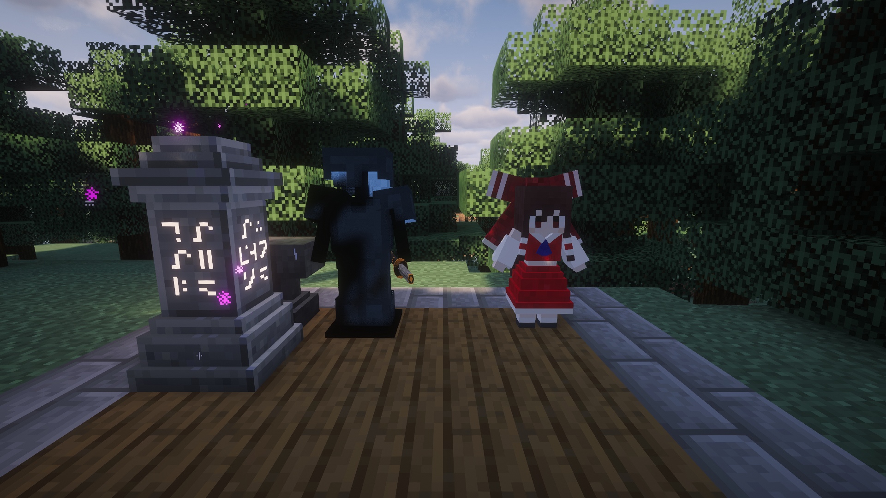
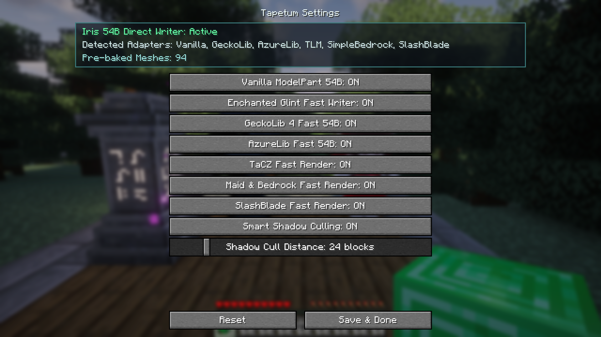

# Tapetum

<p align="center">
  
</p>

**Accelerates entity, armor, and high-poly modded model rendering when running shaders with Sodium/Embeddium and Iris/Oculus.**

Named after the *tapetum lucidum* — the reflective crystal layer behind a cat's iris — **Tapetum** eliminates the per-frame CPU bottleneck that happens when Minecraft entities and high-poly mod models are drawn into Iris and Oculus extended shader vertex buffers.



## Why Frame Rates Drop Around Entities With Shaders

Without shaders, Sodium and Embeddium write entity cubes straight into compact 36-byte buffers. As soon as you enable an Iris or Oculus shader pack, every entity, armor piece, block entity, and modded model must be emitted in an extended 54-byte shader layout with per-face tangents, mid-texture coordinates, and material IDs. Most mods (and even vanilla model parts or enchanted glint wrappers) fall back to slow per-vertex conversion, recalculating tangents and allocating temporary vectors on the render thread every single frame.

## What Tapetum Does

- **Direct shader buffer writing for vanilla & modded entities**: Pre-computes face and smooth tangents plus mid-UV coordinates once per model, then streams transformed vertices directly into Iris and Oculus off-heap shader buffers without per-frame conversion passes.
- **Fast-path enchanted glint**: Keeps enchanted armor and weapons on the direct buffer writer fast path instead of dropping back to vertex-by-vertex dual consumer calls.
- **Built-in high-poly mod adapters (all optional, 1.21.1)**: Automatically detects and accelerates models from:
  - **GeckoLib 4** & **AzureLib** (entities, armor, and animated geo models)
  - **Timeless and Classics Zero (TaCZ)** (gun models, Gun Smith Table static baking, batch preservation, and idle thermal-scope fast exit)
  - **Touhou Little Maid**, **SimpleBedrockModel**, & **Kaleidoscope Doll** (bedrock/geo model baking and deduplicated main + shadow pass animation evaluation)
  - **SlashBlade: Resharped** (pre-baked OBJ triangle meshes with smooth shader tangents)
- **Smart shadow-pass culling**: Skips redundant shadow draws for tiny decorative overlays, distant detail layers, and static display blocks beyond a configurable radius while keeping primary character silhouettes intact.
- **Live status & per-module toggles**: Open the config screen via Mod Menu (Fabric) or the Mods list (Forge & NeoForge) to see whether the direct shader writer is active, which mod adapters are loaded, and how many meshes are currently pre-baked.



## Configuration

Configure in-game or edit `config/tapetum.json`:

```json
{
  "vanillaModelPart54B": true,
  "enchantedGlintFastWriter": true,
  "geckolibFast54B": true,
  "azurelibFast54B": true,
  "taczFastRender": true,
  "maidAndBedrockFastRender": true,
  "slashBladeFastRender": true,
  "smartShadowCulling": true,
  "shadowCullDistance": 24.0
}
```

## Compatibility & Requirements

- **Client performance mod** (safe to leave in server mod folders — client rendering hooks never load on dedicated servers).
- **No hard dependencies**: Designed for **Sodium / Embeddium** + **Iris / Oculus Shaders**, and safely idles if installed without shaders or without any of the supported content mods.
